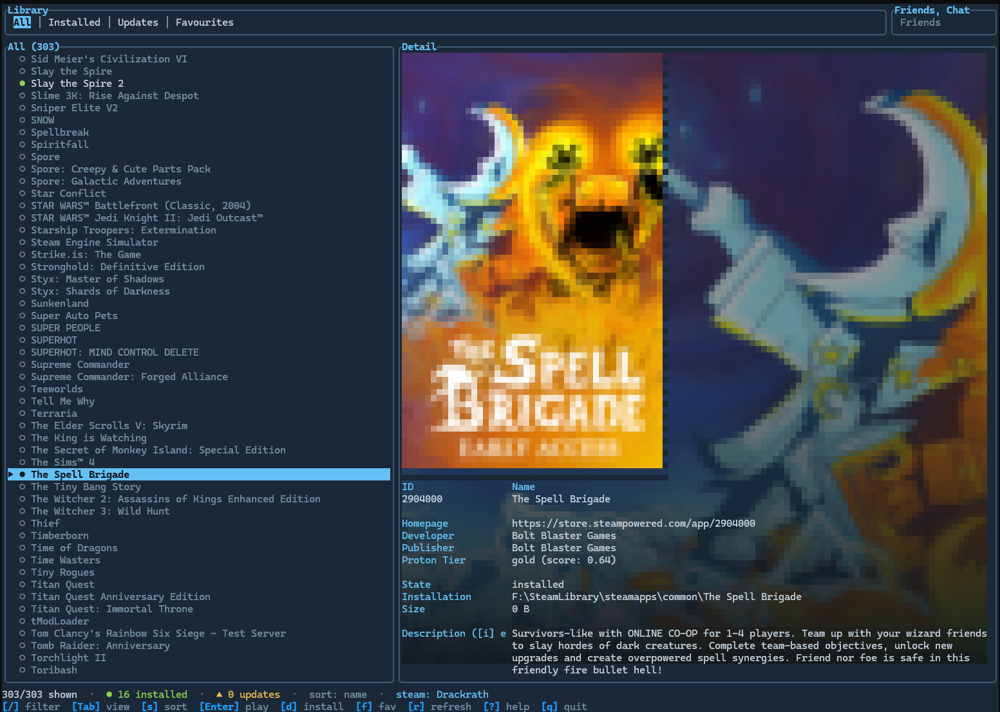

# Aurelia TUI: a terminal UI for your Steam library

**Browse, install, update and launch your Steam games from the terminal, powered by the [`aurelia`](https://github.com/Drackrath/Aurelia) command-line Steam launcher.**

[](LICENSE)
[](https://www.rust-lang.org/)
[](https://github.com/Drackrath/Aurelia#project-status)
[](https://github.com/Drackrath/Aurelia-TUI/releases/latest)
[](https://github.com/Drackrath/Aurelia)

<br clear="left" />

[](https://discord.gg/rcvxd3gpcA) [](https://ko-fi.com/drackrath)

<p align="center">
  
</p>

## About

Aurelia TUI is a graphical front-end for the `aurelia` CLI. It is a rebuild of
[`steam-tui`](https://github.com/dmadisetti/steam-tui): where the original drove
`steamcmd` directly, Aurelia TUI shells out to the modern `aurelia` binary
(using its `--json` output for every backend operation) and lets it handle the
heavy lifting — authentication, library listing, downloads, and launching
(including Proton/Wine on Linux).

> [!NOTE]
> Steam no longer offers a backend-only mode, so a CLI-driven client like this
> is necessarily limited — but it stays useful if you'd rather not run the full
> Steam client.

## Requirements

- The [`aurelia`](https://github.com/Drackrath/Aurelia) CLI, **version `>= 0.3.1`**
  (on Arch: the [`aurelia`](https://aur.archlinux.org/packages/aurelia) AUR
  package; otherwise build it from source).
- A Steam account (logging in is described below).

Aurelia TUI looks for the `aurelia` binary in this order:

1. The `AURELIA_BIN` environment variable, if set (point it at a specific build).
2. The path chosen in Settings (`p`, then the "Aurelia binary" row; empty means
   automatic), saved in the TUI's `config.json`.
3. A sibling `Aurelia` checkout next to this project
   (`../Aurelia/target/release/` or `.../debug/`) — handy when developing both.
4. `aurelia` on your `PATH`.

The TUI remembers which binary (path, size, modification time) it last ran.
When that changes, Aurelia itself restarts its session daemon on the next
command, so the TUI only shows a notice and never restarts the daemon in a loop.

If none of these resolve, the sign-in screen tells you the binary couldn't be
found. The detected `aurelia` version is shown in the bottom-right corner of the
library footer, in the warning colour if it is older than 0.3.1 or missing.

## Building

It's a standard Rust project:

```bash
cargo build --release
./target/release/aurelia-tui
```

## Usage

Launch `aurelia-tui` and you're off — the in-app help bar always shows the keys
for the current screen.

On startup it checks your session with `aurelia login --health --json` (which
reflects either a stored session or a running `aurelia` daemon). If you're
already signed in, it goes straight to your library.

### Signing in

If no session is found, you get a sign-in screen with two options:

- **`Enter` — username & password**, entered inside the TUI. If Steam Guard asks
  for a code, you type it on the next screen. The password is handed to `aurelia`
  through the `AURELIA_PASSWORD` environment variable so it never appears in the
  process list — but it is still typed into the TUI, so use QR if you'd rather it
  never be entered here at all.
- **`y` — QR code**, scanned with the Steam Mobile app. Nothing secret is typed
  anywhere; it shells out to `aurelia login --qr`.

Either path loads your library automatically once you authenticate. You can also
log in out-of-band with `aurelia login` in a terminal, then press `r` on the
sign-in screen to re-check the session.

### Browsing

The library is a single live browser: **filter tabs** across the top
(`All · Installed · Updates · Favourites`, plus a `Friends` tab), the game list
with **status badges** (`●` installed, `▲` update, `⬇` downloading, `○` not
installed, `♡` favourite), a detail pane with cover art, and a **status bar**
showing live counts, the active filter/sort, your account, and the `aurelia`
version. Press `?` any time for the full key list.

#### Keys

| Key | Action |
| --- | --- |
| `j` / `↓`, `k` / `↑` | Move down / up (mouse wheel works too) |
| `g` / `G` | Jump to top / bottom |
| `PageUp` / `PageDown` | Page through the list |
| `Tab` / `Shift-Tab` | Cycle tabs |
| `1`–`5` | Jump straight to a tab (`5` = Friends) |
| `/` | Focus the live fuzzy filter (type to narrow, `Esc` clears) |
| `s` | Cycle sort (name / installed-first / playtime) |
| `Enter` | Open the Actions menu for the selected game |
| `i` | Expand / collapse the store details (`PgUp` / `PgDn` scroll them) |
| `,ct` | Open the selected game’s HowLongToBeat page or retry a failed lookup |
| `d` | Install (pick a library, platform and language) |
| `Space` / `c` | Pause / resume, or cancel, an install |
| `B` | Install queue (pause, resume, stop, forget) |
| `U` / `v` / `x` | Update, verify, or uninstall (optionally deleting the Wine prefix) |
| `V` | Versions & pinning (downgrade to a manifest) |
| `b` / `o` / `D` | Beta branches, depots, DLC |
| `P` / `E` | Proton runtimes, runtime plugins (umu / luxtorpeda / Steam runtime) |
| `C` / `W` / `a` / `I` | Cloud saves (sync, up, down), Workshop, achievements, inventory |
| `M` / `K` / `N` / `O` | Move, relink, import an install; collections |
| `m` / `S` / `w` | Market listings, market search, wallet |
| `R` | Running games |
| `f` / `H` | Toggle favourite, hide the game |
| `A` / `p` | Account, Settings |
| `F` | Friends tab (chat, invite, profiles) |
| `r` | Refresh the library from Steam |
| `l` | Sign in again |
| `?` | Toggle the help overlay |
| `q` | Quit |

### The Actions menu

`Enter` opens a filterable command palette with every action that applies to the
selected game, grouped by topic — type to narrow it, `Enter` to run. Some entries
live only here:

- **Play as…** lists every way the game can be started (`aurelia
  launch-targets`): the native Linux build, or the Windows build with the in-Wine
  Steam runtime, the host Steam client, or no Steam. `Enter` launches one for that
  run only; `d` makes it your choice for Play, `a` goes back to automatic.
  Unavailable targets say what's missing, and a missing Steam runtime can be
  installed from here (`i`, asks first).
- **Game settings** holds the per-game overrides: runner, forced Proton,
  platform, Steam runtime, Steam prefix (each opens a picker), launch script,
  Steam integration, launch options (Steam-style, `%command%` supported), a
  custom Wine prefix, and Aurelia's per-game Steam Cloud switch.
- **Change language** switches an installed game's language (Aurelia downloads
  the language depots).
- **Process Vulkan shaders** and **Play without shader processing**.
- **Open on SteamDB**, **Aurelia log** (stderr of play, install and shader
  runs), and **Reconnect Steam session**.

Anything that downloads, deletes or changes your account asks for `y` first.

Selecting a game fetches its details lazily — developer/publisher metadata
(`aurelia info`), the ProtonDB compatibility tier, and cover art all load in the
background, so navigation stays responsive while they fill in.

HowLongToBeat completion times also load after selection settles. The detail
pane shows Main Story, Main + Extras, and Completionist times; `—` means no
submitted time for that style. PCGamingWiki maps Steam IDs to HLTB pages, with
HLTB title search as fallback; matches are verified against HLTB's Steam IDs.
Press `,ct` (or choose **HowLongToBeat page** in
Actions) to open the verified match. The row stays hidden until a result is
available. `Cached` marks older estimates shown during refresh or retained after
a failed refresh. Failed lookups show `Fetch Failed`; press `,ct` to retry.
See [HowLongToBeat](docs/HOWLONGTOBEAT.md) for matching,
cache, and troubleshooting details. To disable HLTB lookups and hide its
content, press `p`, then `h`; the setting is saved locally.

### Settings

`p` opens Settings: move with `j` / `k`, change a row with `Enter`. The TUI's own
options (HowLongToBeat, syncing saves around Play, store language, `aurelia`
binary) sit above Aurelia's (presence, profile wait, Steam Cloud sync, download
limit, shader pre-caching, anti-cheat runtimes, proxy). Each row also has a
shortcut letter, shown next to it.

### Steam Cloud

With "Sync saves around Play" on (the default), the TUI downloads a game's cloud
saves before launch and uploads them after it exits, but never after a launch
that failed to start. Conflicts ask whether to keep the cloud or the local copy.
The list and detail pane show each game's last sync result.

### Friends

The Friends tab shows statuses, chat, game invites (`i`) and profiles (`p`, `m`
for your own). While the Steam client runs on the same machine, Steam sends no
friend names; the TUI then fills them in slowly in the background and remembers
them between sessions.

## Features not in the help

A little Easter egg for reading the documentation.

### Favourites

`f` toggles a favourite (shown with a ♡), and the Favourites tab (`4`) filters
the list down to just your favourites.

### Hiding games

`H` hides the selected game. Hidden games are recorded in
`~/.config/aurelia-tui/config.json`.

### Showing other app types (demos, tools, …)

By default only `Game` and `DLC` entries are shown. Edit the `allowed_games`
field in the config to include any of `Game`, `DLC`, `Driver`, `Application`,
`Config`, `Demo`, `Tool`, or `Unknown`.

## Configuration & data

| Path | Contents | Override |
| --- | --- | --- |
| `~/.config/aurelia-tui/` | `config.json` (favourites, hidden games, allowed types, highlight colour, TUI settings, launch target choices, Steam integration), `pending_dlc.json` (DLC changes waiting for a Steam restart) | `AURELIA_TUI_DIR` |
| `~/.cache/aurelia-tui/` | cached library (`games.json`), `cloud_sync_status.json`, `friend_names.json`, `aurelia.log` (rotated at 1 MiB) | `AURELIA_TUI_CACHE_DIR` |
| `~/.cache/aurelia-tui/hltb/` | cached HowLongToBeat matches and completion times | `AURELIA_TUI_CACHE_DIR` (parent directory) |
| `~/.cache/aurelia-tui/hltb/pcgamingwiki/` | cached Steam-to-HLTB page mappings | `AURELIA_TUI_CACHE_DIR` (parent directory) |
| `~/.cache/aurelia-tui/icons/` | cached cover art | `AURELIA_TUI_ICON_DIR` |

Launching, Proton/Wine, and runtime concerns are all handled by `aurelia play`,
so there are no wrapper scripts or separate runtimes to manage on your side.

## Credits

- [steam-tui](https://github.com/dmadisetti/steam-tui) — the original client this
  is rebuilt from, by [@dmadisetti](https://github.com/dmadisetti) and contributors
- [aurelia](https://github.com/Drackrath/Aurelia) — the CLI backend
- [steam-vent](https://codeberg.org/steam-vent/steam-vent) — Steam protocol implementation

## License

Distributed under GPL-3.0. See [`LICENSE`](LICENSE) for details.
